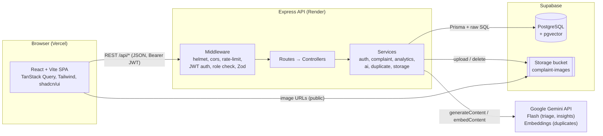
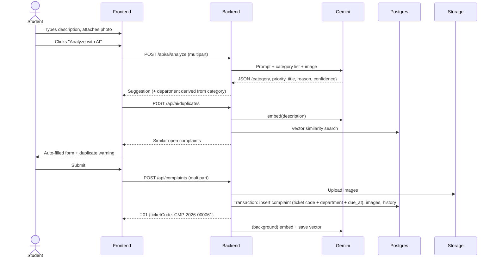
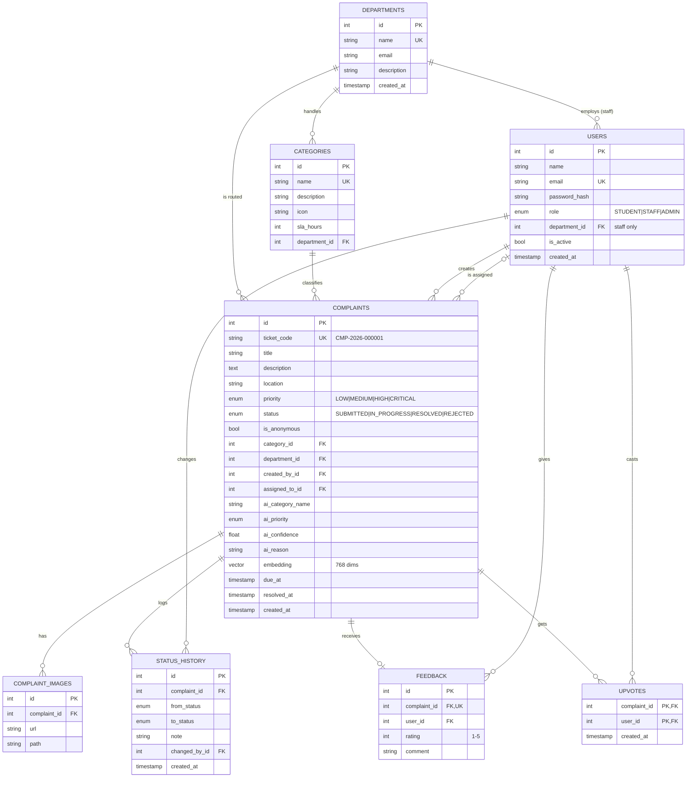

# CampusFix — Master Plan

> **REVA Weekend Hackathon · 24 Oct 2026 · Problem Statement #3: Smart Campus Complaint and Grievance Management System**
>
> This document is the single source of truth for the team **and for every coding agent**. Paste it (or the relevant sections) into your agent's context before you start. If the code and this document disagree, fix one of them and tell the team.

---

## Table of Contents

1. [Product Summary](#1-product-summary)
2. [How We Win: Evaluation Mapping](#2-how-we-win-evaluation-mapping)
3. [Scope: Features and Priorities](#3-scope-features-and-priorities)
4. [Roles and Permissions](#4-roles-and-permissions)
5. [Tech Stack](#5-tech-stack)
6. [System Architecture](#6-system-architecture)
7. [Repository Structure and Ownership](#7-repository-structure-and-ownership)
8. [Environment Variables](#8-environment-variables)
9. [Database Design](#9-database-design)
10. [API Specification](#10-api-specification)
11. [AI Integration Design](#11-ai-integration-design)
12. [Frontend Requirements](#12-frontend-requirements)
13. [Security and Validation](#13-security-and-validation)
14. [Team Split and Agent Prompts](#14-team-split-and-agent-prompts)
15. [Git Workflow and Agent Rules](#15-git-workflow-and-agent-rules)
16. [Timeline and Checkpoints](#16-timeline-and-checkpoints)
17. [Deployment Guide](#17-deployment-guide)
18. [Testing Checklist](#18-testing-checklist)
19. [Demo Script and Presentation](#19-demo-script-and-presentation)
20. [Risks and Fallbacks](#20-risks-and-fallbacks)

---

## 1. Product Summary

**CampusFix** is a web platform where students and staff report campus issues (broken infrastructure, Wi-Fi, cleanliness, transport, hostel, safety) and track them until they are resolved. AI reads the complaint text and photo, then suggests the category, priority and responsible department. It also warns about duplicate complaints, and gives admins a plain-English summary of trends.

**One-line pitch:** *"ServiceNow for campus, with AI triage: report in 30 seconds, routed instantly, tracked transparently."*

**Problem:** Campus complaints today go through WhatsApp groups, paper registers and word of mouth. There is no ticket ID, no owner, no deadline and no data, so issues get lost, duplicated or ignored, and management cannot see which departments are struggling.

**Solution flow (from the problem statement):**

```
Login → Submit Complaint (AI auto-fills) → Ticket ID generated → Auto-assigned to Department
      → Staff updates status (with timeline) → Resolved → Student feedback → Analytics
```

**User types:**

| Role | Who | Main goal |
|---|---|---|
| Student | Students and general campus users | Report issues, track status, upvote existing issues, give feedback |
| Staff | Department staff (IT, Facilities, etc.) | Work through their department's queue, assign, update status |
| Admin | Campus administration | See everything, manage categories/departments/users, view analytics and AI insights |

---

## 2. How We Win: Evaluation Mapping

The evaluation sheet has 5 criteria with no weights, so assume they count equally. Every feature should earn marks in at least one of them.

| # | Criterion | What we show | Owner |
|---|---|---|---|
| 1 | Problem Understanding & Solution Design | Problem slide, user roles, architecture diagram, ER diagram, this plan | All |
| 2 | Prototype Functionality (CRUD) | Full CRUD on complaints, categories, departments, users; status workflow; feedback; upvotes; all working on the **deployed** link | Backend + DB + Frontend |
| 3 | AI Integration & Technical Implementation | AI triage (text + image), duplicate detection with pgvector, AI admin insights, AI accuracy metric; JWT + role-based access, validation, audit trail, transactions | Backend + DB |
| 4 | User Experience (UI/UX) | Clean responsive UI, AI auto-fill shown live in the form, status timeline, dashboards with charts, loading/empty states, toasts | Frontend |
| 5 | Demo Presentation & Teamwork | Scripted 4-minute demo, each member presents their own layer, commits from all 3 members on GitHub | All |

---

## 3. Scope: Features and Priorities

**P0 = must ship. P1 = ship next. P2 = only if everything else is done and deployed.**

| ID | Feature | Priority |
|---|---|---|
| F1 | Register (student) / login (all roles) with JWT; role-based routing | P0 |
| F2 | Create complaint with title, description, category, location, priority, up to 3 images | P0 |
| F3 | Auto-generated ticket code `CMP-2026-000123` | P0 |
| F4 | Auto-route to department based on category; SLA deadline (`due_at`) from category | P0 |
| F5 | My complaints list with filters, search, pagination | P0 |
| F6 | Complaint detail with images, status timeline, AI suggestion info | P0 |
| F7 | Edit/delete own complaint while status is `SUBMITTED` | P0 |
| F8 | Staff queue (their department), assign to staff, change status with note | P0 |
| F9 | Status lifecycle `SUBMITTED → IN_PROGRESS → RESOLVED / REJECTED` with history | P0 |
| F10 | **AI triage**: description (+ optional photo) → category, priority, title, reason, confidence | P0 |
| F11 | Admin dashboard: KPI cards + charts (category, department, trend, resolution time) | P0 |
| F12 | Admin CRUD: categories, departments, users | P0 |
| F13 | Public tracking page by ticket code (no login) | P0 |
| F14 | Seed data: realistic departments, categories, users, ~60 complaints | P0 |
| F15 | Deployed frontend + backend + database | P0 |
| F16 | Feedback (1–5 stars + comment) after resolution | P1 |
| F17 | Campus feed: browse open complaints, "Me too" upvote | P1 |
| F18 | **AI duplicate detection** using Gemini embeddings + pgvector | P1 |
| F19 | Overdue SLA badges and an overdue filter | P1 |
| F20 | **AI insights** panel for admin (trend summary + recommendations) | P1 |
| F21 | AI accuracy metric ("% of AI suggestions kept by users") | P1 |
| F22 | Anonymous complaint option (name hidden from staff) | P2 |
| F23 | Dark mode | P2 |
| F24 | Email notification on status change | P2 |
| F25 | QR code per location that pre-fills the form | P2 |

**Out of scope:** real-time websockets, mobile app, SSO, multi-campus support.

---

## 4. Roles and Permissions

| Action | Student | Staff | Admin |
|---|---|---|---|
| Register themselves | Yes (as STUDENT only) | No (created by admin/seed) | No (seed) |
| Create complaint | Yes | Yes | Yes |
| View own complaints | Yes | Yes | Yes |
| View department complaints | No | Own department only | All |
| View campus feed (open complaints, creator hidden) | Yes | Yes | Yes |
| Edit/delete own complaint | Only while `SUBMITTED` | Only while `SUBMITTED` | Any, any time |
| Change status | No | Own department | Any |
| Assign complaint | No | Own department, to staff in same department | Any |
| Upvote | Yes, not own complaint | Yes, not own complaint | Yes, not own complaint |
| Give feedback | Own complaint, once, after `RESOLVED` | Same | Same |
| Analytics | No | Own department (scoped automatically) | All |
| AI insights | No | No | Yes |
| Manage categories/departments/users | No | No | Yes |

**Status transition rules (enforced in backend):**

| From | Allowed to | Notes |
|---|---|---|
| `SUBMITTED` | `IN_PROGRESS`, `REJECTED` | Assigning a `SUBMITTED` complaint moves it to `IN_PROGRESS` automatically |
| `IN_PROGRESS` | `RESOLVED`, `REJECTED` | `RESOLVED` sets `resolved_at` |
| `RESOLVED` | `IN_PROGRESS` | Reopen, admin/staff only, note required |
| `REJECTED` | none | Final |

A note is **required** for `REJECTED` and for reopening. Every transition writes a `status_history` row inside the same database transaction.

---

## 5. Tech Stack

| Layer | Technology | Why |
|---|---|---|
| Frontend | **React 19 + Vite + TypeScript** | Fast dev server, typed contract with backend |
| Styling | **Tailwind CSS v4 + shadcn/ui** + lucide-react icons | Professional UI quickly |
| Data fetching | **TanStack Query v5** + Axios | Caching, loading/error states for free |
| Forms | **React Hook Form + Zod** | Validation that matches the backend |
| Routing | **React Router v7** | Role-based protected routes |
| Charts | **Recharts** | Dashboard charts |
| Toasts / dates | sonner, date-fns | |
| Backend | **Node.js 20+ / Express 5 + TypeScript** (`tsx` for dev, `tsc` for build) | Required by the problem statement; Express 5 forwards async errors automatically |
| ORM | **Prisma 6** (pin `prisma@6` and `@prisma/client@6`) | Typed queries, migrations. Prisma 7 changed the config format, so stay on 6 |
| Validation | **Zod** | Shared style with frontend |
| Auth | **JWT** (`jsonwebtoken`) + **bcryptjs** | Stateless, simple |
| Uploads | **Multer** (memory storage) → **Supabase Storage** | No local disk on Render |
| Security | helmet, cors, express-rate-limit, morgan | |
| Database | **PostgreSQL on Supabase** with **pgvector** | Free hosted Postgres + vector search + file storage in one place |
| AI | **Google Gemini API** via `@google/genai` | Free tier; text + image input; JSON output; embeddings |
| AI models | Generation: `gemini-2.5-flash` (or the newest Flash model in AI Studio). Embeddings: `gemini-embedding-001` with `outputDimensionality: 768` | Set via env vars so they can be changed without code changes |
| Hosting | **Vercel** (frontend), **Render** (backend), **Supabase** (DB + storage) | All free tiers, deploy from GitHub |
| Tooling | GitHub, Postman, Mermaid (diagrams), Figma (optional wireframes) | Listed in problem statement |

---

## 6. System Architecture



**Request flow when creating a complaint:**



**Key design decisions:**

- The backend derives the **department from the category**. It never trusts the client or the AI for routing.
- The AI only **suggests**. The user can change any field. We store both the AI suggestion and the final choice, which gives us the AI accuracy metric.
- If Gemini fails or is rate-limited, the backend falls back to keyword rules (`source: "fallback"`). The app never breaks because of AI.
- Embeddings are generated in the background after the complaint is created, so creating a complaint never waits on AI.
- All multi-step writes (create, status change, assign) use Prisma transactions.

---

## 7. Repository Structure and Ownership

One monorepo: `campusfix/`. Each folder or file has **one owner**. Agents must only edit files their owner owns (see [Section 15](#15-git-workflow-and-agent-rules)).

```
campusfix/
├── MASTER_PLAN.md                  # this file (everyone reads, edits only by agreement)
├── AGENTS.md                       # short rules for coding agents (Backend lead creates)
├── README.md                       # setup, demo accounts, screenshots, diagrams (DB member)
├── docs/
│   ├── er-diagram.md               # Mermaid ER diagram (DB member)
│   ├── architecture.md             # architecture diagrams (Backend lead)
│   └── CampusFix.postman_collection.json   # (DB member, exported from Postman)
├── frontend/                       # ── OWNER: Member 1 (Frontend) ──
│   ├── index.html
│   ├── vercel.json                 # SPA rewrites
│   ├── .env.example
│   ├── package.json
│   └── src/
│       ├── main.tsx
│       ├── App.tsx                 # router
│       ├── index.css               # Tailwind + theme tokens
│       ├── lib/        api.ts, utils.ts, constants.ts
│       ├── types/      index.ts    # mirrors Section 10 shapes exactly
│       ├── context/    AuthContext.tsx
│       ├── hooks/      useAuth.ts, useComplaints.ts, useAnalytics.ts, useAi.ts, ...
│       ├── components/
│       │   ├── ui/             # shadcn components
│       │   ├── layout/         AppShell, Sidebar, Topbar, ProtectedRoute, RoleRedirect
│       │   ├── complaints/     StatusBadge, PriorityBadge, ComplaintCard, ComplaintTable,
│       │   │                   ComplaintFilters, StatusTimeline, ImageUploader, ImageGallery,
│       │   │                   AiSuggestionBadge, DuplicateWarning, FeedbackForm,
│       │   │                   StatusUpdateDialog, AssignDialog, UpvoteButton
│       │   └── dashboard/      KpiCard, CategoryPieChart, DepartmentBarChart,
│       │                       TrendLineChart, ResolutionTimeChart, AiInsightsPanel
│       └── pages/
│           ├── public/     LandingPage, TrackPage, LoginPage, RegisterPage, NotFoundPage
│           ├── student/    MyComplaintsPage, NewComplaintPage, FeedPage
│           ├── shared/     ComplaintDetailPage, EditComplaintPage, ProfilePage
│           ├── staff/      QueuePage
│           └── admin/      DashboardPage, AllComplaintsPage, CategoriesPage,
│                           DepartmentsPage, UsersPage
└── backend/
    ├── package.json                # ── OWNER: Backend lead ──
    ├── tsconfig.json
    ├── .env.example
    ├── src/                        # ── OWNER: Backend lead (except files marked DB) ──
    │   ├── server.ts               # starts HTTP server
    │   ├── app.ts                  # express app, middleware, route mounting
    │   ├── config/env.ts           # Zod-validated env
    │   ├── lib/        prisma.ts, supabase.ts, gemini.ts
    │   ├── middleware/ auth.ts, validate.ts, upload.ts, rateLimit.ts, errorHandler.ts
    │   ├── routes/     auth, complaints, track, categories, departments, users, analytics, ai
    │   ├── controllers/ (one per route file)
    │   ├── services/
    │   │   ├── auth.service.ts
    │   │   ├── complaint.service.ts
    │   │   ├── storage.service.ts
    │   │   ├── ai.service.ts
    │   │   ├── analytics.service.ts      # ── OWNER: DB member ──
    │   │   └── duplicate.service.ts      # ── OWNER: DB member ── (embeddings + vector search)
    │   ├── validators/ (Zod schemas per resource)
    │   └── utils/      ApiError.ts, response.ts, keywordFallback.ts, statusRules.ts
    └── prisma/                     # ── OWNER: DB member ──
        ├── schema.prisma
        ├── migrations/
        ├── seed.ts
        ├── embed-seed.ts           # generates embeddings for seeded complaints
        └── sql/
            ├── analytics-queries.sql   # reference queries used by analytics.service.ts
            └── vector-index.sql
```

---

## 8. Environment Variables

**Never commit `.env`.** Commit `.env.example` with empty values.

### `backend/.env`

```bash
PORT=4000
NODE_ENV=development

# Supabase → Project Settings → Database → Connection string
# Pooled connection (port 6543) for the app:
DATABASE_URL="postgresql://postgres.<ref>:<password>@aws-0-<region>.pooler.supabase.com:6543/postgres?pgbouncer=true&connection_limit=1"
# Direct/session connection (port 5432) for migrations:
DIRECT_URL="postgresql://postgres.<ref>:<password>@aws-0-<region>.pooler.supabase.com:5432/postgres"

JWT_SECRET="<long random string>"
JWT_EXPIRES_IN="7d"

# Comma-separated list of allowed frontend origins
CORS_ORIGIN="http://localhost:5173,https://campusfix.vercel.app"

# Supabase → Project Settings → API
SUPABASE_URL="https://<ref>.supabase.co"
SUPABASE_SERVICE_KEY="<service_role or secret key — backend only, never in frontend>"
SUPABASE_BUCKET="complaint-images"

# Google AI Studio → Get API key
GEMINI_API_KEY="<key>"
GEMINI_MODEL="gemini-2.5-flash"
GEMINI_EMBED_MODEL="gemini-embedding-001"
AI_TIMEOUT_MS=10000
```

### `frontend/.env`

```bash
VITE_API_URL="http://localhost:4000/api"
VITE_USE_MOCKS=true
VITE_SECURITY_PHONE="<campus security number>"
```

The DB member creates the Supabase project and shares the connection strings and keys **privately** (a DM, not the repo).

---

## 9. Database Design

### 9.1 ER Diagram



### 9.2 Prisma Schema (`backend/prisma/schema.prisma`)

This is the contract. The backend and frontend types depend on these names.

```prisma
generator client {
  provider = "prisma-client-js"
}

datasource db {
  provider  = "postgresql"
  url       = env("DATABASE_URL")
  directUrl = env("DIRECT_URL")
}

enum Role {
  STUDENT
  STAFF
  ADMIN
}

enum ComplaintStatus {
  SUBMITTED
  IN_PROGRESS
  RESOLVED
  REJECTED
}

enum Priority {
  LOW
  MEDIUM
  HIGH
  CRITICAL
}

model Department {
  id          Int         @id @default(autoincrement())
  name        String      @unique
  email       String?
  description String?
  createdAt   DateTime    @default(now()) @map("created_at")
  users       User[]
  categories  Category[]
  complaints  Complaint[]

  @@map("departments")
}

model User {
  id                 Int             @id @default(autoincrement())
  name               String
  email              String          @unique
  passwordHash       String          @map("password_hash")
  role               Role            @default(STUDENT)
  departmentId       Int?            @map("department_id")
  department         Department?     @relation(fields: [departmentId], references: [id], onDelete: SetNull)
  isActive           Boolean         @default(true) @map("is_active")
  createdAt          DateTime        @default(now()) @map("created_at")
  updatedAt          DateTime        @updatedAt @map("updated_at")
  complaints         Complaint[]     @relation("CreatedComplaints")
  assignedComplaints Complaint[]     @relation("AssignedComplaints")
  statusChanges      StatusHistory[]
  feedback           Feedback[]
  upvotes            Upvote[]

  @@index([role])
  @@map("users")
}

model Category {
  id           Int         @id @default(autoincrement())
  name         String      @unique
  description  String?
  icon         String?     // lucide icon name, e.g. "wifi"
  slaHours     Int         @default(48) @map("sla_hours")
  departmentId Int         @map("department_id")
  department   Department  @relation(fields: [departmentId], references: [id], onDelete: Restrict)
  complaints   Complaint[]
  createdAt    DateTime    @default(now()) @map("created_at")

  @@map("categories")
}

model Complaint {
  id             Int                          @id @default(autoincrement())
  ticketCode     String                       @unique @default(dbgenerated("('CMP-' || to_char(now(), 'YYYY') || '-' || lpad(nextval('complaint_ticket_seq')::text, 6, '0'))")) @map("ticket_code")
  title          String
  description    String
  location       String
  priority       Priority                     @default(MEDIUM)
  status         ComplaintStatus              @default(SUBMITTED)
  isAnonymous    Boolean                      @default(false) @map("is_anonymous")

  categoryId     Int                          @map("category_id")
  category       Category                     @relation(fields: [categoryId], references: [id], onDelete: Restrict)
  departmentId   Int                          @map("department_id")
  department     Department                   @relation(fields: [departmentId], references: [id], onDelete: Restrict)
  createdById    Int                          @map("created_by_id")
  createdBy      User                         @relation("CreatedComplaints", fields: [createdById], references: [id], onDelete: Cascade)
  assignedToId   Int?                         @map("assigned_to_id")
  assignedTo     User?                        @relation("AssignedComplaints", fields: [assignedToId], references: [id], onDelete: SetNull)

  aiCategoryName String?                      @map("ai_category_name")
  aiPriority     Priority?                    @map("ai_priority")
  aiConfidence   Float?                       @map("ai_confidence")
  aiReason       String?                      @map("ai_reason")
  embedding      Unsupported("vector(768)")?

  dueAt          DateTime?                    @map("due_at")
  resolvedAt     DateTime?                    @map("resolved_at")
  createdAt      DateTime                     @default(now()) @map("created_at")
  updatedAt      DateTime                     @updatedAt @map("updated_at")

  images         ComplaintImage[]
  history        StatusHistory[]
  feedback       Feedback?
  upvotes        Upvote[]

  @@index([status])
  @@index([departmentId, status])
  @@index([categoryId])
  @@index([createdById])
  @@index([assignedToId])
  @@index([createdAt])
  @@map("complaints")
}

model ComplaintImage {
  id          Int       @id @default(autoincrement())
  complaintId Int       @map("complaint_id")
  complaint   Complaint @relation(fields: [complaintId], references: [id], onDelete: Cascade)
  url         String
  path        String    // storage object path, used for deletion
  createdAt   DateTime  @default(now()) @map("created_at")

  @@index([complaintId])
  @@map("complaint_images")
}

model StatusHistory {
  id          Int              @id @default(autoincrement())
  complaintId Int              @map("complaint_id")
  complaint   Complaint        @relation(fields: [complaintId], references: [id], onDelete: Cascade)
  fromStatus  ComplaintStatus? @map("from_status")
  toStatus    ComplaintStatus  @map("to_status")
  note        String?
  changedById Int              @map("changed_by_id")
  changedBy   User             @relation(fields: [changedById], references: [id], onDelete: Cascade)
  createdAt   DateTime         @default(now()) @map("created_at")

  @@index([complaintId, createdAt])
  @@map("status_history")
}

model Feedback {
  id          Int       @id @default(autoincrement())
  complaintId Int       @unique @map("complaint_id")
  complaint   Complaint @relation(fields: [complaintId], references: [id], onDelete: Cascade)
  userId      Int       @map("user_id")
  user        User      @relation(fields: [userId], references: [id], onDelete: Cascade)
  rating      Int       // 1..5, validated in API + CHECK constraint
  comment     String?
  createdAt   DateTime  @default(now()) @map("created_at")

  @@map("feedback")
}

model Upvote {
  complaintId Int       @map("complaint_id")
  complaint   Complaint @relation(fields: [complaintId], references: [id], onDelete: Cascade)
  userId      Int       @map("user_id")
  user        User      @relation(fields: [userId], references: [id], onDelete: Cascade)
  createdAt   DateTime  @default(now()) @map("created_at")

  @@id([complaintId, userId])
  @@map("upvotes")
}
```

### 9.3 First Migration (important: the sequence and the extension)

The ticket code default uses a Postgres sequence, and the embedding column needs pgvector. Both must exist **before** the `complaints` table is created.

1. Supabase Dashboard → Database → Extensions → enable **vector**.
2. Create the migration without applying it:
   ```bash
   cd backend
   npx prisma migrate dev --create-only --name init
   ```
3. Open `prisma/migrations/<timestamp>_init/migration.sql` and add these lines **at the very top**:
   ```sql
   CREATE EXTENSION IF NOT EXISTS vector;
   CREATE SEQUENCE IF NOT EXISTS complaint_ticket_seq START 1;
   ```
   And at the **bottom**:
   ```sql
   ALTER TABLE "feedback" ADD CONSTRAINT feedback_rating_check CHECK (rating BETWEEN 1 AND 5);
   CREATE INDEX IF NOT EXISTS complaints_embedding_idx
     ON "complaints" USING hnsw (embedding vector_cosine_ops);
   ```
4. Apply it: `npx prisma migrate dev`
5. Seed: `npx prisma db seed` (configure `"prisma": { "seed": "tsx prisma/seed.ts" }` in `backend/package.json`).

**Fallback if `migrate dev` has trouble with the shadow database on Supabase:** run the two `CREATE` lines in the Supabase SQL editor, then `npx prisma db push`, then run the bottom SQL in the SQL editor. Tell the team you used `db push`.

### 9.4 Seed Data (`prisma/seed.ts`)

The seed must make the dashboards look real during the demo. Use `bcryptjs` to hash passwords.

**Departments (6):** IT Services, Facilities & Maintenance, Housekeeping, Transport, Hostel & Mess, Safety & Security.

**Categories (12):**

| Category | Department | SLA hours | Icon |
|---|---|---|---|
| Wi-Fi & Network | IT Services | 24 | `wifi` |
| Computer Lab & Projectors | IT Services | 48 | `monitor` |
| Electrical | Facilities & Maintenance | 24 | `zap` |
| Plumbing & Water | Facilities & Maintenance | 24 | `droplets` |
| Furniture & Infrastructure | Facilities & Maintenance | 72 | `armchair` |
| Classroom Facilities | Facilities & Maintenance | 48 | `school` |
| Cleanliness | Housekeeping | 24 | `sparkles` |
| Washrooms | Housekeeping | 12 | `bath` |
| Bus & Transport | Transport | 48 | `bus` |
| Hostel Rooms | Hostel & Mess | 48 | `bed` |
| Mess & Food Quality | Hostel & Mess | 24 | `utensils` |
| Safety & Security | Safety & Security | 4 | `shield-alert` |

**Demo accounts (put these in the README and on a slide):**

| Role | Email | Password |
|---|---|---|
| Admin | `admin@campusfix.edu` | `Admin@123` |
| Staff (IT Services) | `it.staff@campusfix.edu` | `Staff@123` |
| Staff (Facilities) | `facilities.staff@campusfix.edu` | `Staff@123` |
| Staff (Housekeeping) | `housekeeping.staff@campusfix.edu` | `Staff@123` |
| Student | `student@campusfix.edu` | `Student@123` |

Plus: 1 more staff per remaining department, and ~10 extra students with Indian names.

**Complaints (~60):**
- Realistic REVA-style locations: "Block A, Room 204", "Central Library, 2nd Floor", "Boys Hostel B, Room 112", "Main Canteen", "Bus Route 7 (Yelahanka)", "CSE Lab 3", "Auditorium", "Parking Lot 2".
- Realistic descriptions, 1–3 sentences each, written like a real student would.
- `created_at` spread over the **last 30 days**, with more in the last 7 days (so the trend chart shows a rise).
- Status mix: ~25% SUBMITTED, ~30% IN_PROGRESS, ~35% RESOLVED, ~10% REJECTED.
- Each complaint gets a consistent `status_history` (SUBMITTED → ... → current status) with realistic gaps and notes from staff.
- `resolved_at` set for resolved ones (resolution times between 2 and 96 hours, with IT faster than Facilities).
- `due_at = created_at + category.sla_hours`. Make ~8 open complaints overdue.
- `assigned_to_id` set for all IN_PROGRESS/RESOLVED ones (staff of the right department).
- AI fields filled for ~80% of complaints; `ai_category_name` matches the final category in ~85% of those (gives a realistic AI accuracy number).
- Feedback for ~70% of resolved complaints (ratings mostly 3–5).
- Random upvotes (0–12 per open complaint), with a few popular ones.
- Make Wi-Fi in a specific block a visible cluster (5–6 complaints) so the AI insights have something to say and duplicate detection has something to find.

**Images in seed:** optional. Use a few public Unsplash URLs in `complaint_images.url` with `path = ''`.

### 9.5 Embeddings for Seed Data (`prisma/embed-seed.ts`)

Script (`npm run db:embed`) that loops over complaints with `embedding IS NULL`, calls `duplicate.service.embedText(title + "\n" + description)`, and saves the vector. Add a ~700 ms delay between calls to stay under the free-tier rate limit.

### 9.6 Reference SQL (used by `analytics.service.ts` and `duplicate.service.ts`)

Use `prisma.$queryRaw` with tagged templates (parameterized; never string concatenation with user input). Convert `bigint` counts to `Number` before returning JSON.

**Summary KPIs** (add `WHERE department_id = $dept` when called by staff):

```sql
SELECT
  COUNT(*)                                                         AS total,
  COUNT(*) FILTER (WHERE status = 'SUBMITTED')                     AS submitted,
  COUNT(*) FILTER (WHERE status = 'IN_PROGRESS')                   AS in_progress,
  COUNT(*) FILTER (WHERE status = 'RESOLVED')                      AS resolved,
  COUNT(*) FILTER (WHERE status = 'REJECTED')                      AS rejected,
  COUNT(*) FILTER (WHERE status IN ('SUBMITTED','IN_PROGRESS') AND due_at < now()) AS overdue,
  ROUND(AVG(EXTRACT(EPOCH FROM (resolved_at - created_at)) / 3600)
        FILTER (WHERE resolved_at IS NOT NULL)::numeric, 1)        AS avg_resolution_hours,
  COUNT(*) FILTER (WHERE created_at >= now() - interval '7 days')  AS last_7_days
FROM complaints;
-- avg rating:
SELECT ROUND(AVG(rating)::numeric, 2) AS avg_rating FROM feedback;
```

**By category:**

```sql
SELECT c.id, c.name, c.icon, COUNT(x.id) AS count
FROM categories c
LEFT JOIN complaints x ON x.category_id = c.id
GROUP BY c.id ORDER BY count DESC;
```

**By department (with performance):**

```sql
SELECT d.id, d.name,
  COUNT(x.id)                                                  AS total,
  COUNT(x.id) FILTER (WHERE x.status IN ('SUBMITTED','IN_PROGRESS')) AS open,
  COUNT(x.id) FILTER (WHERE x.status = 'RESOLVED')             AS resolved,
  COUNT(x.id) FILTER (WHERE x.status IN ('SUBMITTED','IN_PROGRESS') AND x.due_at < now()) AS overdue,
  ROUND(AVG(EXTRACT(EPOCH FROM (x.resolved_at - x.created_at)) / 3600)
        FILTER (WHERE x.resolved_at IS NOT NULL)::numeric, 1)  AS avg_resolution_hours
FROM departments d
LEFT JOIN complaints x ON x.department_id = d.id
GROUP BY d.id ORDER BY total DESC;
```

**Daily trend (created vs resolved, last N days):**

```sql
SELECT to_char(day, 'YYYY-MM-DD') AS date,
  (SELECT COUNT(*) FROM complaints WHERE created_at::date  = day) AS created,
  (SELECT COUNT(*) FROM complaints WHERE resolved_at::date = day) AS resolved
FROM generate_series(current_date - ($1::int - 1), current_date, interval '1 day') AS day
ORDER BY day;
```

**AI accuracy:**

```sql
SELECT
  COUNT(*) FILTER (WHERE x.ai_category_name IS NOT NULL)          AS ai_suggested,
  COUNT(*) FILTER (WHERE x.ai_category_name = c.name)             AS category_kept,
  COUNT(*) FILTER (WHERE x.ai_priority = x.priority)              AS priority_kept
FROM complaints x JOIN categories c ON c.id = x.category_id;
```

**Save embedding:**

```sql
UPDATE complaints SET embedding = $1::vector WHERE id = $2;
-- $1 is a string like '[0.0123,-0.0456,...]' (768 numbers)
```

**Find similar open complaints:**

```sql
SELECT x.id, x.ticket_code, x.title, x.location, x.status,
       c.name AS category_name,
       (SELECT COUNT(*) FROM upvotes u WHERE u.complaint_id = x.id) AS upvote_count,
       1 - (x.embedding <=> $1::vector) AS similarity
FROM complaints x
JOIN categories c ON c.id = x.category_id
WHERE x.embedding IS NOT NULL
  AND x.status IN ('SUBMITTED', 'IN_PROGRESS')
  AND x.created_at >= now() - interval '30 days'
ORDER BY x.embedding <=> $1::vector
LIMIT 5;
-- In code: keep only rows with similarity >= 0.80
```

---

## 10. API Specification

**Base URL:** `{VITE_API_URL}` → `http://localhost:4000/api` locally, `https://campusfix-api.onrender.com/api` in production.

### 10.1 Conventions

- JSON everywhere, except endpoints marked **multipart**.
- Auth: `Authorization: Bearer <jwt>`. JWT payload: `{ sub: userId, role, departmentId }`.
- Dates are ISO 8601 strings in UTC. IDs are integers.
- Enum values are uppercase strings exactly as in the Prisma schema.

**Success envelope:**

```json
{ "success": true, "data": { }, "meta": { "page": 1, "limit": 10, "total": 57, "totalPages": 6 } }
```

`meta` appears only on paginated list endpoints.

**Error envelope:**

```json
{ "success": false, "error": { "code": "VALIDATION_ERROR", "message": "Description must be at least 10 characters", "details": [{ "path": "description", "message": "..." }] } }
```

| HTTP | `error.code` | When |
|---|---|---|
| 400 | `VALIDATION_ERROR` | Zod validation failed |
| 401 | `UNAUTHORIZED` | Missing/invalid/expired token, wrong login |
| 403 | `FORBIDDEN` | Role or ownership check failed |
| 404 | `NOT_FOUND` | Resource missing (or not visible to this user) |
| 409 | `CONFLICT` | Duplicate email, already upvoted, feedback exists, delete blocked by references |
| 422 | `INVALID_TRANSITION` | Status change not allowed, edit after SUBMITTED, feedback before RESOLVED |
| 429 | `RATE_LIMITED` | Too many requests |
| 500 | `INTERNAL_ERROR` | Anything else (never leak stack traces in production) |

**Pagination query params:** `page` (default 1), `limit` (default 10, max 50).

### 10.2 Shared Response Shapes (frontend `types/index.ts` must match)

```ts
type Role = "STUDENT" | "STAFF" | "ADMIN";
type ComplaintStatus = "SUBMITTED" | "IN_PROGRESS" | "RESOLVED" | "REJECTED";
type Priority = "LOW" | "MEDIUM" | "HIGH" | "CRITICAL";

interface Ref { id: number; name: string }

interface User {
  id: number;
  name: string;
  email: string;
  role: Role;
  department: Ref | null;
  isActive: boolean;
  createdAt: string;
}

interface Category {
  id: number;
  name: string;
  description: string | null;
  icon: string | null;
  slaHours: number;
  department: Ref;
  complaintCount?: number;      // included on admin list
}

interface Department {
  id: number;
  name: string;
  email: string | null;
  description: string | null;
  staffCount?: number;
  categoryCount?: number;
}

interface ComplaintSummary {
  id: number;
  ticketCode: string;
  title: string;
  location: string;
  status: ComplaintStatus;
  priority: Priority;
  category: Ref & { icon: string | null };
  department: Ref;
  createdBy: Ref | null;        // null when anonymous and viewer is not owner/admin, and always null in the campus feed
  assignedTo: Ref | null;
  isAnonymous: boolean;
  upvoteCount: number;
  hasUpvoted: boolean;
  isOverdue: boolean;           // open && dueAt < now
  dueAt: string | null;
  resolvedAt: string | null;
  thumbnailUrl: string | null;  // first image
  createdAt: string;
  updatedAt: string;
}

interface StatusHistoryEntry {
  id: number;
  fromStatus: ComplaintStatus | null;
  toStatus: ComplaintStatus;
  note: string | null;
  changedBy: Ref & { role: Role };
  createdAt: string;
}

interface ComplaintDetail extends ComplaintSummary {
  description: string;
  images: { id: number; url: string }[];
  history: StatusHistoryEntry[];          // oldest first
  feedback: { rating: number; comment: string | null; createdAt: string } | null;
  ai: { categoryName: string | null; priority: Priority | null; confidence: number | null; reason: string | null } | null;
  permissions: {                          // computed by backend for the current user, used to show/hide buttons
    canEdit: boolean;
    canDelete: boolean;
    canChangeStatus: boolean;
    canAssign: boolean;
    canUpvote: boolean;
    canGiveFeedback: boolean;
    allowedTransitions: ComplaintStatus[];
  };
}

interface AiSuggestion {
  category: Ref | null;          // matched to a real DB category
  department: Ref | null;        // derived from category
  priority: Priority;
  suggestedTitle: string;
  reason: string;                // one sentence, shown in the UI
  confidence: number;            // 0..1
  isSafetyIssue: boolean;
  source: "ai" | "fallback";
}

interface SimilarComplaint {
  id: number;
  ticketCode: string;
  title: string;
  location: string;
  status: ComplaintStatus;
  categoryName: string;
  upvoteCount: number;
  similarity: number;            // 0..1
}
```

### 10.3 Endpoint Overview

| Method | Path | Auth | Description |
|---|---|---|---|
| GET | `/health` | Public | Health check (also used to wake Render) |
| POST | `/auth/register` | Public | Register a student |
| POST | `/auth/login` | Public | Login, returns token + user |
| GET | `/auth/me` | Any | Current user |
| PUT | `/auth/me` | Any | Update own name / password |
| GET | `/complaints` | Any | Role-scoped list with filters |
| GET | `/complaints/feed` | Any | Campus-wide open complaints (creator hidden) |
| POST | `/complaints` | Any | Create complaint (**multipart**) |
| GET | `/complaints/:id` | Any (scoped) | Complaint detail |
| PUT | `/complaints/:id` | Owner (SUBMITTED) / Admin | Update complaint |
| DELETE | `/complaints/:id` | Owner (SUBMITTED) / Admin | Delete complaint + images |
| POST | `/complaints/:id/images` | Owner (SUBMITTED) / Admin | Add images (**multipart**) |
| DELETE | `/complaints/:id/images/:imageId` | Owner (SUBMITTED) / Admin | Remove image |
| PATCH | `/complaints/:id/status` | Staff (own dept) / Admin | Change status |
| PATCH | `/complaints/:id/assign` | Staff (own dept) / Admin | Assign to staff |
| POST | `/complaints/:id/upvote` | Any (not owner) | Upvote |
| DELETE | `/complaints/:id/upvote` | Any | Remove upvote |
| POST | `/complaints/:id/feedback` | Owner (RESOLVED) | Give feedback |
| GET | `/track/:ticketCode` | Public | Public tracking |
| GET | `/categories` | Any | List categories |
| POST | `/categories` | Admin | Create |
| PUT | `/categories/:id` | Admin | Update |
| DELETE | `/categories/:id` | Admin | Delete (409 if in use) |
| GET | `/departments` | Any | List departments |
| POST | `/departments` | Admin | Create |
| PUT | `/departments/:id` | Admin | Update |
| DELETE | `/departments/:id` | Admin | Delete (409 if in use) |
| GET | `/departments/:id/staff` | Staff / Admin | Staff list for the assign dropdown |
| GET | `/users` | Admin | List users (filters) |
| POST | `/users` | Admin | Create staff/admin/student |
| PUT | `/users/:id` | Admin | Update user |
| DELETE | `/users/:id` | Admin | Deactivate user (`isActive=false`) |
| GET | `/analytics/summary` | Staff / Admin | KPI numbers |
| GET | `/analytics/by-category` | Staff / Admin | Counts per category |
| GET | `/analytics/by-department` | Admin | Department performance |
| GET | `/analytics/trend?days=30` | Staff / Admin | Daily created vs resolved |
| GET | `/analytics/ai-accuracy` | Admin | AI suggestion acceptance |
| POST | `/ai/analyze` | Any | AI triage (**multipart**) |
| POST | `/ai/duplicates` | Any | Similar open complaints |
| GET | `/ai/insights` | Admin | AI summary of trends |

Staff calls to `/analytics/*` are automatically scoped to their own department.

### 10.4 Endpoint Details

#### Auth

**`POST /auth/register`**

```json
// request
{ "name": "Ananya Rao", "email": "ananya@campusfix.edu", "password": "Secret@123" }
// 201 response
{ "success": true, "data": { "token": "eyJ...", "user": { "id": 21, "name": "Ananya Rao", "email": "ananya@campusfix.edu", "role": "STUDENT", "department": null, "isActive": true, "createdAt": "..." } } }
```

Rules: name 2–80 chars; valid email; password ≥ 8 chars with at least one letter and one number; email lowercased; 409 if email exists. Always creates `STUDENT`.

**`POST /auth/login`** → `{ email, password }` → same response as register. 401 with message "Invalid email or password" for both unknown email and wrong password. 403 if `isActive=false`.

**`GET /auth/me`** → `{ user }`. **`PUT /auth/me`** → `{ name?, currentPassword?, newPassword? }` (`currentPassword` required when changing password).

#### Complaints

**`GET /complaints`** — role-scoped:
- STUDENT: only their own complaints.
- STAFF: complaints in their department.
- ADMIN: all complaints.

Query params (all optional):

| Param | Type | Notes |
|---|---|---|
| `status` | enum, comma-separated | `SUBMITTED,IN_PROGRESS` |
| `priority` | enum, comma-separated | |
| `categoryId` | int | |
| `departmentId` | int | Admin only (ignored for others) |
| `assignedTo` | `me` \| int \| `unassigned` | Staff/Admin |
| `overdue` | `true` | Open and past `due_at` |
| `search` | string | Matches ticket code, title, description, location (case-insensitive) |
| `from`, `to` | ISO date | `created_at` range |
| `sort` | `newest` (default) \| `oldest` \| `priority` \| `upvotes` \| `due` | |
| `page`, `limit` | int | |

Response: `data: ComplaintSummary[]`, plus `meta`.

**`GET /complaints/feed`** — open complaints (`SUBMITTED`, `IN_PROGRESS`) campus-wide for upvoting. Same filters minus `assignedTo`; `createdBy` is always `null`. Default sort: `upvotes`.

**`POST /complaints`** — **multipart/form-data**

| Field | Type | Rules |
|---|---|---|
| `title` | string | 5–120 chars |
| `description` | string | 10–2000 chars |
| `location` | string | 2–120 chars |
| `categoryId` | int | must exist |
| `priority` | enum | default `MEDIUM` |
| `isAnonymous` | `"true"`/`"false"` | default false |
| `aiCategoryName` | string | optional, from `/ai/analyze` |
| `aiPriority` | enum | optional |
| `aiConfidence` | number | optional, 0..1 |
| `aiReason` | string | optional |
| `images` | file[] | 0–3 files, jpg/png/webp, ≤ 5 MB each |

Backend steps:
1. Validate. Look up the category and get `departmentId` and `slaHours`.
2. Upload images to Supabase Storage at `complaints/{uuid}.{ext}` and collect public URLs.
3. In a transaction: create the complaint (`departmentId` from category, `dueAt = now + slaHours`), the image rows, and the first `status_history` row (`fromStatus: null → SUBMITTED`, note "Complaint submitted").
4. Respond `201` with `ComplaintDetail`.
5. In the background (don't await): `duplicate.service.embedAndStore(complaint.id)`.

If image upload fails, return 500 and don't create the complaint. If the DB write fails after the uploads, delete the uploaded files.

**`GET /complaints/:id`** → `ComplaintDetail`. Visible to the owner, staff of that department, and admins. Returns 404 (not 403) for others, so we don't reveal that the complaint exists.

**`PUT /complaints/:id`** → JSON with any of `title, description, location, categoryId, priority, isAnonymous`. Owner only while `SUBMITTED` (else 422), admin always. Changing `categoryId` recalculates `departmentId` and `dueAt`. Clears the embedding and re-embeds in the background.

**`DELETE /complaints/:id`** → `204`. Deletes storage files, then the row (cascades to images, history, upvotes, feedback).

**`PATCH /complaints/:id/status`**

```json
// request
{ "status": "RESOLVED", "note": "Router in Library 2F replaced. Speed tested at 80 Mbps." }
// 200 → ComplaintDetail (with the new history entry)
```

Validates against the transition table in Section 4 (`utils/statusRules.ts`). Sets `resolvedAt` on `RESOLVED`, clears it on reopen. Transaction: update complaint + insert history.

**`PATCH /complaints/:id/assign`**

```json
{ "assignedToId": 7 }   // or null to unassign
```

Assignee must be an active STAFF user in the complaint's department (else 422). If status is `SUBMITTED`, also move it to `IN_PROGRESS`. Writes a history row with note `"Assigned to <name>"`.

**`POST /complaints/:id/upvote`** → `200 { upvoteCount, hasUpvoted: true }`. 422 if own complaint; 409 if already upvoted; 422 if complaint is closed. **`DELETE`** → `{ upvoteCount, hasUpvoted: false }`.

**`POST /complaints/:id/feedback`** → `{ rating: 1..5, comment?: string ≤ 500 }` → `201 { feedback }`. Owner only; status must be `RESOLVED` (422); once only (409).

#### Public Tracking

**`GET /track/:ticketCode`** (case-insensitive)

```json
{
  "success": true,
  "data": {
    "ticketCode": "CMP-2026-000042",
    "title": "Wi-Fi not working on Library 2nd floor",
    "status": "IN_PROGRESS",
    "priority": "HIGH",
    "category": "Wi-Fi & Network",
    "department": "IT Services",
    "createdAt": "...",
    "updatedAt": "...",
    "dueAt": "...",
    "timeline": [
      { "status": "SUBMITTED", "at": "..." },
      { "status": "IN_PROGRESS", "at": "..." }
    ]
  }
}
```

No names, emails, notes, descriptions or images.

#### Categories / Departments / Users (Admin CRUD)

- `POST/PUT /categories` → `{ name, description?, icon?, slaHours (1..720), departmentId }`. Name unique (409).
- `POST/PUT /departments` → `{ name, email?, description? }`. Name unique (409).
- `DELETE` on either returns 409 with a friendly message if complaints or categories still reference it.
- `GET /departments/:id/staff` → `Ref[]` of active STAFF in that department (staff may only query their own department).
- `GET /users?role=STAFF&departmentId=2&search=ravi&page=1` → `User[]` + `meta`.
- `POST /users` → `{ name, email, password, role, departmentId? }`. `departmentId` is required when `role = STAFF`.
- `PUT /users/:id` → `{ name?, role?, departmentId?, isActive?, password? }`.
- `DELETE /users/:id` → sets `isActive=false` (soft delete). An admin cannot deactivate themselves.

#### Analytics

```jsonc
// GET /analytics/summary
{ "total": 61, "submitted": 15, "inProgress": 18, "resolved": 22, "rejected": 6,
  "overdue": 8, "avgResolutionHours": 26.4, "avgRating": 4.2, "last7Days": 24 }

// GET /analytics/by-category
[ { "id": 1, "name": "Wi-Fi & Network", "icon": "wifi", "count": 14 }, ... ]

// GET /analytics/by-department
[ { "id": 1, "name": "IT Services", "total": 20, "open": 7, "resolved": 11, "overdue": 2, "avgResolutionHours": 14.2 }, ... ]

// GET /analytics/trend?days=30
[ { "date": "2026-10-01", "created": 2, "resolved": 1 }, ... ]

// GET /analytics/ai-accuracy
{ "aiSuggested": 48, "categoryKept": 41, "priorityKept": 37, "categoryAccuracy": 0.854, "priorityAccuracy": 0.771 }
```

#### AI

**`POST /ai/analyze`** — **multipart**: `description` (required, ≥ 10 chars), `title` (optional), `location` (optional), `image` (optional, single file ≤ 5 MB). Rate-limited to 20 requests/minute per user.

```json
{
  "success": true,
  "data": {
    "category": { "id": 1, "name": "Wi-Fi & Network" },
    "department": { "id": 1, "name": "IT Services" },
    "priority": "HIGH",
    "suggestedTitle": "Wi-Fi down on Library 2nd floor",
    "reason": "Network outage affecting a shared study area used by many students.",
    "confidence": 0.93,
    "isSafetyIssue": false,
    "source": "ai"
  }
}
```

**`POST /ai/duplicates`** → `{ title?: string, description: string, categoryId?: number }` → `data: SimilarComplaint[]` (similarity ≥ 0.80, max 5; empty array if none or if AI is down).

**`GET /ai/insights`** (admin) → cached in memory for 10 minutes; `?refresh=true` forces regeneration.

```json
{
  "success": true,
  "data": {
    "generatedAt": "2026-10-24T11:40:00Z",
    "headline": "Wi-Fi complaints in Block C doubled this week; IT is meeting SLAs but Housekeeping is not.",
    "insights": [
      { "title": "Wi-Fi spike in Block C", "detail": "6 of the last 9 IT complaints mention Block C...", "severity": "high" },
      { "title": "Washroom SLA breaches", "detail": "Housekeeping has 4 overdue washroom complaints...", "severity": "medium" }
    ],
    "recommendations": [
      "Schedule an access point audit in Block C.",
      "Add an evening cleaning shift for Block A washrooms."
    ],
    "source": "ai"
  }
}
```

---

## 11. AI Integration Design

All Gemini calls live in `backend/src/services/ai.service.ts` (generation) and `backend/src/services/duplicate.service.ts` (embeddings). The API key is **backend-only**.

### 11.1 Triage (`analyzeComplaint`)

1. Load categories from the DB (cache in memory for 5 minutes): `id, name, description, department.name`.
2. Call Gemini with `responseMimeType: "application/json"` and a `responseSchema` that makes `categoryName` an **enum of the real category names**, so the model can't invent one.
3. If an image is attached, send it as `inlineData` (base64 + mimeType) together with the text.
4. Map `categoryName` → category row → department. Clamp `confidence` to 0..1.
5. Timeout after `AI_TIMEOUT_MS`. On any error, timeout or invalid JSON → `keywordFallback()`.

**System prompt:**

```text
You are the triage assistant for CampusFix, a university campus complaint system.
Given a complaint (text and optionally a photo), classify it.

Categories (choose exactly one categoryName from this list):
{{#each categories}}- {{name}} (handled by {{department}}): {{description}}
{{/each}}

Priority rules:
- CRITICAL: immediate safety risk — fire, smoke, sparks, exposed live wires, gas smell, flooding near electricity,
  injury, harassment, security threat, someone stuck in a lift.
- HIGH: essential service down for many people — no water, no power in a block, Wi-Fi down for a whole floor
  or building, bus not arriving, food safety issue.
- MEDIUM: something broken that affects a few people or a single room — one projector, one AC, one leaking tap.
- LOW: cosmetic or minor inconvenience — paint, a squeaky chair, a request or suggestion.

Return JSON only:
- categoryName: one of the listed names
- priority: LOW | MEDIUM | HIGH | CRITICAL
- suggestedTitle: a clear title, max 70 characters, no ticket numbers
- reason: one short sentence explaining the category and priority, written for the student
- confidence: number between 0 and 1
- isSafetyIssue: true only for safety risks

If a photo is provided, use what is visible in it. If the text and photo disagree, prefer the text.
```

**Response schema (pass to Gemini):**

```ts
{
  type: "object",
  properties: {
    categoryName: { type: "string", enum: categoryNames },
    priority: { type: "string", enum: ["LOW", "MEDIUM", "HIGH", "CRITICAL"] },
    suggestedTitle: { type: "string" },
    reason: { type: "string" },
    confidence: { type: "number" },
    isSafetyIssue: { type: "boolean" }
  },
  required: ["categoryName", "priority", "suggestedTitle", "reason", "confidence", "isSafetyIssue"]
}
```

### 11.2 Keyword Fallback (`utils/keywordFallback.ts`)

A keyword → category map (for example `wifi|internet|network|router` → Wi-Fi & Network, `fan|light|switch|power|socket` → Electrical, `water|leak|tap|pipe` → Plumbing & Water, `dirty|garbage|dustbin|smell` → Cleanliness, `toilet|washroom|restroom` → Washrooms, `bus|driver|route` → Bus & Transport, `food|mess|canteen` → Mess & Food Quality, `fire|spark|shock|harass|unsafe|theft` → Safety & Security). Priority from keywords (`fire|spark|shock|injur` → CRITICAL, `not working|down|no water|no power` → HIGH, else MEDIUM). `confidence: 0.4`, `source: "fallback"`, `reason: "Suggested using keyword matching."`. Title = first 70 characters of the description, cleaned up.

### 11.3 Duplicate Detection (`duplicate.service.ts`, DB member)

- `embedText(text): Promise<number[]>` → Gemini `embedContent` with model `GEMINI_EMBED_MODEL`, `outputDimensionality: 768`, task type `SEMANTIC_SIMILARITY`.
- `embedAndStore(complaintId)` → loads the title and description, embeds them, and runs the `UPDATE ... ::vector` query. Catch and log all errors (it runs in the background).
- `findSimilar({ title, description, categoryId? })` → embeds the input and runs the similarity query from 9.6. Filters to `similarity >= 0.80`. If `categoryId` is given, rank same-category results first. Returns `[]` on any AI error.

### 11.4 Admin Insights (`getInsights`)

1. Gather data: summary, by-department, by-category counts for the **last 7 days vs the previous 7 days**, the top 5 most-upvoted open complaints (title + location), and overdue counts by department.
2. Send it to Gemini as JSON with a prompt: *"You are an operations analyst for a university facilities office. From this data, write a one-sentence headline, 3–5 insights (title, detail, severity: low|medium|high) that mention concrete numbers and locations, and 2–4 practical recommendations. JSON only."* Use a response schema.
3. Cache the result for 10 minutes. On failure, return a simple rule-based version (top category, the department with the most overdue complaints) with `source: "fallback"`.

### 11.5 AI Rules

- Never send emails, passwords or student names to Gemini; send only complaint text, location, category and department names, and numbers.
- Log every AI call's latency and `source`. Useful to show in the demo ("average AI response 1.4 s").
- Free-tier quotas are small. The frontend calls `/ai/analyze` only when the user clicks the button, never on each keystroke.

---

## 12. Frontend Requirements

### 12.1 Routes

| Path | Page | Access |
|---|---|---|
| `/` | LandingPage: hero, how it works (3 steps), "Track your complaint" input, login/register buttons, feature highlights | Public |
| `/track/:ticketCode` | TrackPage: status stepper + timeline | Public |
| `/login`, `/register` | Auth pages; demo-account quick-fill buttons on login (great for judges) | Public |
| `/app` | RoleRedirect → student: `/app/complaints`, staff: `/app/queue`, admin: `/app/dashboard` | Any |
| `/app/complaints` | MyComplaintsPage (student/staff: own; admin: AllComplaintsPage) | Any |
| `/app/complaints/new` | NewComplaintPage (AI form) | Any |
| `/app/complaints/:id` | ComplaintDetailPage | Scoped |
| `/app/complaints/:id/edit` | EditComplaintPage | Owner (SUBMITTED) / Admin |
| `/app/feed` | FeedPage: campus open complaints + upvote | Any |
| `/app/queue` | QueuePage: department queue table | Staff, Admin |
| `/app/dashboard` | DashboardPage | Staff (scoped), Admin |
| `/app/admin/categories` | CategoriesPage (table + create/edit dialog) | Admin |
| `/app/admin/departments` | DepartmentsPage | Admin |
| `/app/admin/users` | UsersPage | Admin |
| `/app/profile` | ProfilePage | Any |
| `*` | NotFoundPage | Public |

### 12.2 Layout

- **AppShell:** left sidebar (collapsible into a drawer on mobile) + top bar (page title, user menu with role badge, logout).
- **Sidebar items by role:**
  - Student: My Complaints, Raise Complaint, Campus Feed, Profile.
  - Staff: Queue, Dashboard, Raise Complaint, Campus Feed, Profile.
  - Admin: Dashboard, All Complaints, Queue, Categories, Departments, Users, Campus Feed, Profile.
- A primary "Raise Complaint" button is always visible in the top bar.

### 12.3 Key Screens

**NewComplaintPage (the most important screen for the demo):**

1. Step 1, "Describe the issue": large textarea, optional location, image uploader (drag and drop, previews, max 3, remove button).
2. Button **"✨ Analyze with AI"** (disabled until the description is ≥ 10 chars). While loading, show a shimmer over the fields with the text "AI is reading your complaint…".
3. On response: animate the title, category, priority and department into the fields. Each AI-filled field shows a small **"AI suggested"** badge; hovering shows the `reason`. Show the confidence as a pill (e.g. "93% confident"). If `source = "fallback"`, show a neutral "Suggested by keywords" badge instead.
4. If `isSafetyIssue`, show a red alert banner: "This looks like a safety issue. It will be marked CRITICAL. For emergencies, call campus security: <number>."
5. Then call `/ai/duplicates`. If results exist, show a **DuplicateWarning** card: "Similar open complaints found" with up to 3 items (ticket, title, location, status, similarity %, upvotes) and a **"This is my issue too"** button that upvotes and navigates to that complaint. The user can still continue.
6. The user can edit any field. If they change an AI-filled field, the badge disappears (we still send the original AI values for the accuracy metric).
7. Department is read-only and updates when the category changes ("Will be routed to: IT Services · SLA 24h").
8. Anonymous toggle, then Submit → success screen with a large ticket code, copy button, "Track status" and "View complaint" buttons, and a confetti or checkmark animation.

The user can also skip AI and fill in the fields manually.

**ComplaintDetailPage:**
- Header: ticket code (copy button), title, Status badge, Priority badge, Overdue badge if relevant.
- Left column: description, image gallery (click to open in a lightbox), location, category → department, created date, SLA deadline with a countdown ("Due in 5h" / "Overdue by 3h").
- Right column: **StatusTimeline** (vertical stepper: who, when, note), assigned staff, upvote count.
- AI card: "AI suggested *Wi-Fi & Network · HIGH* (93%)", and whether the user kept it.
- Action buttons shown according to `permissions`: Edit, Delete (with a confirm dialog), Change Status (dialog: select from `allowedTransitions` + note, note required for REJECTED/reopen), Assign (dialog: staff dropdown from `/departments/:id/staff`), Upvote, Give Feedback (stars + comment, only when allowed).

**MyComplaintsPage / AllComplaintsPage / QueuePage:**
- Filter bar: search, status multi-select, priority, category, (admin) department, overdue toggle, sort, and for staff an "Assigned to me / Unassigned / All" segmented control.
- Students: cards in a grid (thumbnail, title, ticket, status, category icon, time ago). Staff/admin: a dense table (ticket, title, category, priority, status, assignee, age, due).
- Pagination, empty states with illustration and CTA, skeleton loaders.
- Filters sync to the URL query string so links can be shared.

**DashboardPage:**
- KPI cards: Total, Open, Resolved, Overdue (red), Avg Resolution Time, Avg Rating, AI Accuracy.
- Charts: complaints by category (donut), department performance (grouped bar: open/resolved/overdue), 30-day trend (line: created vs resolved), avg resolution hours by department (horizontal bar).
- **AiInsightsPanel**: headline, insight cards colored by severity, recommendations list, "Regenerate" button, "Generated 3 min ago".
- Recent complaints table (latest 5) and an overdue list.
- Staff see the same page scoped to their department (hide the department-comparison chart).

**Admin CRUD pages:** table + search + "Add" button opening a dialog form; edit uses the same dialog; delete uses a confirm dialog and shows the 409 message on conflict.

**TrackPage:** a large horizontal stepper Submitted → In Progress → Resolved (or Rejected in red), with dates under each step, category, department and SLA status. Mobile-first: this is the page judges might open on their phones.

### 12.4 Design System

- Font: **Inter**. Rounded corners `rounded-xl`, soft shadows, lots of white space. Max content width ~1280px.
- Primary color: **indigo-600**. Neutral: slate.
- **Status colors:** SUBMITTED = blue, IN_PROGRESS = amber, RESOLVED = emerald, REJECTED = rose.
- **Priority colors:** LOW = slate, MEDIUM = sky, HIGH = orange, CRITICAL = red (with a pulsing dot).
- Category icons from lucide using `category.icon`.
- AI elements use a subtle violet gradient border and a sparkle icon, so AI features are visually recognisable throughout the app.
- Every list has a loading skeleton, an empty state and an error state with a retry button.
- Every mutation shows a toast (success/error message from `error.message`).
- Fully responsive: test at 375px (phone), 768px and 1440px.
- Accessible: labels on all inputs, focus rings, color is never the only indicator (badges include text).

### 12.5 Frontend Technical Rules

- `lib/api.ts`: Axios instance with `baseURL = import.meta.env.VITE_API_URL`; a request interceptor adds the JWT; a response interceptor unwraps the envelope to `{ data, meta }` (`meta` is `undefined` for non-paginated endpoints) and on 401 clears the token and redirects to `/login`.
- Campus security number for the safety banner comes from `VITE_SECURITY_PHONE` (placeholder until the team confirms the real number).
- Auth state in `AuthContext` (token in `localStorage`, user loaded from `/auth/me` on startup).
- One TanStack Query hook per endpoint; invalidate the related queries after mutations (for example, after a status change invalidate `["complaint", id]`, `["complaints"]` and `["analytics"]`).
- Forms use React Hook Form + Zod with the same limits as the backend (Section 10.4).
- Until the backend is ready, use mock data in `src/mocks/` matching the Section 10.2 types exactly, behind `VITE_USE_MOCKS=true`.
- `vercel.json`: `{ "rewrites": [{ "source": "/(.*)", "destination": "/index.html" }] }`.

---

## 13. Security and Validation

- Passwords hashed with bcryptjs (10 rounds). Never return `passwordHash`; use a Prisma `select` or a `toPublicUser()` mapper.
- JWT signed with `JWT_SECRET`, 7-day expiry. Middleware: `authenticate` (verifies the token, loads the user, rejects inactive users) and `authorize(...roles)`.
- Ownership and department checks inside services, not just routes.
- Zod validation middleware for `body`, `query` and `params` on every route.
- `helmet()`, `cors({ origin: CORS_ORIGIN list })`, JSON body limit 1 MB.
- Rate limits: `/auth/*` 20 req/15 min per IP; `/ai/*` 20 req/min per user; global 300 req/15 min per IP.
- Multer: memory storage, only `image/jpeg`, `image/png`, `image/webp`, max 5 MB, max 3 files.
- Raw SQL only via Prisma tagged templates (`$queryRaw\`...\``), never `$queryRawUnsafe` with user input.
- Central error handler maps Zod errors, Prisma errors (`P2002` → 409, `P2025` → 404, `P2003` → 409) and `ApiError` to the error envelope. Hide stack traces in production.
- Secrets only in `.env` / hosting dashboards. `SUPABASE_SERVICE_KEY` and `GEMINI_API_KEY` never reach the frontend.

---

## 14. Team Split and Agent Prompts

| Member | Owns | Main deliverables |
|---|---|---|
| **Member 1: Frontend** | `frontend/` | All pages and components in Section 12, design system, responsive layout, connecting to the API, Vercel deployment |
| **Member 2: Backend + Deployment (Harsha)** | `backend/src/` (except DB-owned files), `backend/package.json`, `AGENTS.md`, `docs/architecture.md` | Repo scaffold, auth, all routes/controllers/services, AI triage + insights, image upload, error handling, Render deployment, CORS/env setup |
| **Member 3: Database** | `backend/prisma/`, `services/analytics.service.ts`, `services/duplicate.service.ts`, `README.md`, `docs/er-diagram.md`, Postman collection | Supabase setup, schema + migration, seed data, embeddings + vector search, analytics queries, documentation, API testing |

### Starter prompts (paste together with this whole document)

**Member 1 (Frontend):**

```text
You are building the frontend of CampusFix. MASTER_PLAN.md is the contract — follow Sections 10.2, 10.4 and 12 exactly.
Work only inside frontend/. Do not touch backend/ or root docs.
Stack: React 19 + Vite + TypeScript, Tailwind CSS v4, shadcn/ui, lucide-react, TanStack Query v5, Axios,
React Router v7, React Hook Form + Zod, Recharts, sonner, date-fns.
Order of work:
1) Scaffold, Tailwind + shadcn, theme tokens and status/priority colors (12.4), types/index.ts from 10.2.
2) lib/api.ts, AuthContext, ProtectedRoute, RoleRedirect, AppShell with role-based sidebar.
3) Login (with demo-account quick-fill buttons), Register, Landing, Track pages.
4) NewComplaintPage with the full AI flow in 12.3 (analyze → auto-fill with AI badges → duplicate warning → submit → success screen).
5) MyComplaints, ComplaintDetail (timeline, permissions-based actions, dialogs), Edit, Feed.
6) Queue, Dashboard (KPIs, 4 charts, AiInsightsPanel), admin CRUD pages, Profile.
Use mock data behind VITE_USE_MOCKS until the API is live, then switch to the real API.
Every list needs skeleton, empty and error states. Every mutation shows a toast. Must look great at 375px and 1440px.
Commit after each numbered step.
```

**Member 2 (Backend):**

```text
You are building the backend of CampusFix. MASTER_PLAN.md is the contract — follow Sections 4, 8, 10, 11 and 13 exactly.
Work only inside backend/src/, backend/package.json, backend/tsconfig.json and backend/.env.example.
Do not edit backend/prisma/, services/analytics.service.ts or services/duplicate.service.ts (owned by the DB member) —
call their exported functions instead. If they don't exist yet, create a stub with the agreed signature and tell me.
Stack: Node 20, Express 5, TypeScript (tsx for dev, tsc for build), Prisma 6 client, Zod, jsonwebtoken, bcryptjs,
multer, @supabase/supabase-js, @google/genai, helmet, cors, express-rate-limit, morgan.
Order of work:
1) Scaffold: app.ts, server.ts, config/env.ts (Zod), lib/prisma.ts, ApiError, response helpers, errorHandler, validate middleware, /api/health.
2) Auth: register, login, me, authenticate + authorize middleware.
3) Complaints: list (role-scoped + all filters + pagination), feed, create (multipart + Supabase Storage + transaction),
   detail (with permissions object), update, delete, images, status (statusRules.ts + transaction), assign, upvote, feedback.
4) Public track, categories, departments (+ staff list), users CRUD.
5) Analytics routes (calling analytics.service.ts), AI routes: analyze (Gemini text + image, response schema,
   timeout, keyword fallback), duplicates (calling duplicate.service.ts), insights (cached 10 min).
6) Rate limits, CORS list, production build, Render config.
Response envelopes and error codes must match Section 10.1 exactly. Commit after each numbered step.
```

**Member 3 (Database):**

```text
You are responsible for the database layer of CampusFix. MASTER_PLAN.md is the contract — follow Section 9 and 11.3 exactly.
Work only inside backend/prisma/, backend/src/services/analytics.service.ts, backend/src/services/duplicate.service.ts,
README.md, docs/er-diagram.md and docs/ (Postman collection).
Order of work:
1) prisma/schema.prisma exactly as in 9.2. Create the init migration with --create-only, add the extension,
   sequence, CHECK constraint and HNSW index (9.3), then apply it to Supabase.
2) prisma/seed.ts per 9.4: 6 departments, 12 categories, demo accounts, extra staff and students, ~60 realistic
   complaints over 30 days with consistent status_history, assignments, resolved_at, due_at (some overdue),
   AI fields (~85% match), feedback and upvotes, and a Wi-Fi cluster in one block. Make it idempotent (clear tables first).
3) services/analytics.service.ts exporting getSummary(deptId?), getByCategory(deptId?), getByDepartment(),
   getTrend(days, deptId?), getAiAccuracy() using the SQL in 9.6 via prisma.$queryRaw (convert bigint to number).
4) services/duplicate.service.ts exporting embedText(text), embedAndStore(complaintId), findSimilar({title, description, categoryId}) per 11.3,
   using @google/genai with outputDimensionality 768 and task type SEMANTIC_SIMILARITY.
5) prisma/embed-seed.ts (npm run db:embed) to embed all seeded complaints with a delay between calls.
6) README.md (overview, features, tech stack, architecture + ER diagrams in Mermaid, setup steps, env vars,
   demo accounts, API overview, screenshots section) and a Postman collection covering every endpoint in 10.3.
Commit after each numbered step.
```

---

## 15. Git Workflow and Agent Rules

**Repo:** one GitHub repo `campusfix`, all 3 members as collaborators.

**Branches:** `main` (always deployable) + `feat/frontend`, `feat/backend`, `feat/db`. Merge into `main` via quick pull requests at each checkpoint (the PR history also shows teamwork to judges). Pull `main` into your branch after every merge.

**Commits:** small and frequent, conventional style: `feat(api): add complaint status endpoint`, `feat(ui): AI suggestion badges`, `feat(db): seed realistic complaints`, `fix: ...`, `docs: ...`.

**`AGENTS.md` (repo root, created by the backend lead in the scaffold):**

```markdown
# Rules for coding agents
- MASTER_PLAN.md is the source of truth. Read the sections relevant to your task before writing code.
- Only modify files owned by your member (MASTER_PLAN.md Section 7). Never edit another member's folder.
- Do not rename API fields, enum values, routes or database columns. If something in the contract must change,
  stop and ask the human to agree it with the team first.
- Never commit .env files, API keys or secrets.
- Do not add new major dependencies without listing them in your summary.
- Keep changes small; commit after each completed step; never run destructive commands on the shared database
  (no `migrate reset` or `db push --force-reset`) unless the DB member asks.
```

**Contract changes:** if anyone needs to change an endpoint, field or table, tell the team in the group chat first, update this document, then change the code.

---

## 16. Timeline and Checkpoints

Times are relative to the start (T+0). Evaluation begins at **12:30**.

| Phase | Time | Frontend | Backend + Deploy | Database |
|---|---|---|---|---|
| 0. Setup | T+0 → T+20 | Install tools, scaffold Vite app in a temp folder, design tokens | **Create the GitHub repo, scaffold monorepo, `AGENTS.md`, push**; create Render + Vercel accounts; get a Gemini API key | Create the Supabase project, enable pgvector, create the `complaint-images` bucket (public), share env values privately |
| 1. Core | T+20 → T+60 | Auth pages, layout, landing, NewComplaint form (mock data) | Auth, complaint CRUD, upload, status/assign, categories/departments | Schema + migration applied, seed script, analytics.service |
| **Checkpoint 1** | **T+60** | **Merge everything to `main`. Frontend switches to the real API. Fix integration bugs together (15 min max)** | | |
| 2. AI + Dashboards | T+60 → T+100 | AI auto-fill UX, duplicate warning, detail page + dialogs, queue, dashboard + charts | AI analyze + insights, analytics routes, **first deployment to Render by T+80** | duplicate.service + embed-seed, ER diagram, start README + Postman |
| **Checkpoint 2** | **T+100** | **Frontend deployed on Vercel against the Render API. Full demo flow tested on the live link** | | |
| 3. Polish | T+100 → T+130 | Admin CRUD pages, feed, responsive fixes, empty/loading states | P1 features, bug fixes, logs, rate limits | Finish README, Postman collection, screenshots, slides |
| **Feature freeze** | **T+130** | **No new features. Only bug fixes** | | |
| 4. Rehearse | T+130 → 12:30 | **Everyone:** run the demo script twice on the live link, assign speaking parts, warm up the Render backend 5 minutes before evaluation | | |

If you fall behind, cut in this order: F25 → F24 → F23 → F22 → F21 → F20 → F17. **Never cut F10 (AI triage) or F15 (deployment).**

---

## 17. Deployment Guide

### Supabase (DB member)
1. New project (region: Mumbai `ap-south-1`). Save the database password.
2. Database → Extensions → enable `vector`.
3. Storage → New bucket `complaint-images` → **Public**.
4. Copy the pooled (6543) and direct/session (5432) connection strings, the project URL, and the service/secret key.

### Backend on Render (Backend lead)
- New **Web Service** → connect the GitHub repo → **Root Directory:** `backend`.
- **Build command:** `npm ci && npx prisma generate && npm run build`
- **Start command:** `npx prisma migrate deploy && node dist/server.js`
- **Environment:** all variables from Section 8 (`NODE_ENV=production`, `CORS_ORIGIN` including the Vercel URL).
- Health check path: `/api/health`.
- The free tier sleeps after 15 minutes of inactivity (cold start ~50 s). **Open `/api/health` 5 minutes before the demo** and keep a tab open.

`backend/package.json` scripts:

```json
{
  "scripts": {
    "dev": "tsx watch src/server.ts",
    "build": "tsc",
    "start": "node dist/server.js",
    "db:migrate": "prisma migrate dev",
    "db:deploy": "prisma migrate deploy",
    "db:seed": "prisma db seed",
    "db:embed": "tsx prisma/embed-seed.ts",
    "db:studio": "prisma studio"
  },
  "prisma": { "seed": "tsx prisma/seed.ts" }
}
```

### Frontend on Vercel (Frontend member)
- New project → import the repo → **Root Directory:** `frontend` → Framework: Vite.
- Env: `VITE_API_URL=https://<render-service>.onrender.com/api`.
- `vercel.json` with the SPA rewrite (Section 12.5).
- After the first deploy, send the Vercel URL to the backend lead to add to `CORS_ORIGIN`.

### Backup plan
Keep the full app running locally on one laptop (`npm run dev` in both folders against Supabase). If hosting fails during evaluation, demo from localhost.

---

## 18. Testing Checklist

Run through this on the **deployed** link at Checkpoint 2 and again before the demo.

**Auth**
- [ ] Register a new student → lands on My Complaints
- [ ] Login as each demo account → lands on the correct home page
- [ ] Wrong password shows an error toast; refreshing the page keeps you logged in; logout works
- [ ] A student opening `/app/admin/users` is redirected / sees 403

**Complaint lifecycle**
- [ ] AI analyze fills category, priority, title, department with badges and reason (text only, and text + photo)
- [ ] The safety banner appears for "sparks coming from the switchboard in Lab 3"
- [ ] Duplicate warning appears for a Wi-Fi complaint in the seeded cluster block
- [ ] Submit with 2 images → ticket code shown → images visible on the detail page
- [ ] Edit and delete work while SUBMITTED; blocked after IN_PROGRESS
- [ ] Staff (correct department) sees it in the queue; staff of another department does not
- [ ] Assign → status becomes IN_PROGRESS, timeline updated
- [ ] Reject without a note is blocked; resolve with a note works; `resolvedAt` set
- [ ] Student gives feedback once; second attempt blocked
- [ ] Upvote from another student works; can't upvote own complaint
- [ ] Public `/track/CMP-2026-...` works logged out and on a phone

**Admin**
- [ ] Dashboard KPIs and all 4 charts load with seeded data
- [ ] AI insights load and regenerate
- [ ] Create/edit/delete a category and a department; deleting one in use shows the 409 message
- [ ] Create a staff user, log in as them

**Robustness**
- [ ] With an invalid `GEMINI_API_KEY`, analyze still returns a fallback suggestion
- [ ] Uploading a 10 MB file or a PDF shows a clear error
- [ ] Mobile view (375px) is usable on every page
- [ ] No console errors on the main flow

---

## 19. Demo Script and Presentation

### 4-minute live demo

| Time | Who | What |
|---|---|---|
| 0:00–0:30 | Backend lead | **Problem:** "Campus complaints get lost in WhatsApp groups and registers: no ticket, no owner, no deadline, no data." Show the landing page. |
| 0:30–1:30 | Frontend member | **Student flow:** log in with the quick-fill button. Type *"wifi not working in Block C 2nd floor since morning, can't download assignments"* and attach a photo. Click **Analyze with AI** → fields fill themselves (Wi-Fi & Network, HIGH, routed to IT Services, 24h SLA). The duplicate warning shows similar complaints from the seeded Block C cluster → explain upvoting. Submit → ticket `CMP-2026-0000xx`. |
| 1:30–2:15 | Backend lead | **Staff flow:** log in as IT staff → queue → assign → in progress → resolve with a note. Show the timeline. Open the public tracking link on a phone (or let a judge do it). |
| 2:15–3:00 | DB member | **Admin flow:** dashboard KPIs, charts, AI insights panel ("Wi-Fi complaints in Block C doubled…"), AI accuracy 85%. |
| 3:00–4:00 | All (20 s each) | **Under the hood:** Frontend: component architecture, responsive design. Backend: REST API, JWT + roles, AI with fallback, transactions. Database: ER diagram, audit trail, ticket sequence, pgvector similarity search. Close with the deployed URL and GitHub repo. |

**Tip:** Practise the AI step with the exact text above beforehand so you know what it returns. Have a second prepared complaint ready (the electrical sparks one) to show the CRITICAL safety banner if there's time.

### Slides (6 max)

1. **Title:** CampusFix, team names, problem statement #3, deployed URL + QR code.
2. **Problem & users:** pain points, 3 roles.
3. **Solution & features:** the flow diagram from Section 1, key features, AI highlights.
4. **Architecture:** diagram from Section 6, tech stack logos.
5. **Database:** ER diagram, key design points (audit trail, ticket sequence, pgvector, indexes).
6. **Impact & future scope:** faster resolution, accountability, data-driven decisions. Future: mobile app, WhatsApp bot intake, IoT sensor auto-tickets, multi-campus.

---

## 20. Risks and Fallbacks

| Risk | Mitigation |
|---|---|
| Gemini rate limit / outage during the demo | Keyword fallback (analyze), empty array (duplicates), rule-based insights; rehearse with the exact demo text; have a second API key ready |
| Render cold start | Open `/api/health` 5 minutes before; keep a tab open |
| Hosting failure | Demo from localhost against Supabase |
| Merge conflicts between agents | Strict folder ownership (Section 7), `AGENTS.md`, frequent small merges |
| Contract drift (field name mismatch) | Section 10.2 types are the single source; frontend `types/index.ts` copies them exactly |
| Prisma + Supabase migration issues | `db push` fallback in 9.3 |
| Empty-looking dashboards | Rich seed data (9.4) with a clear Wi-Fi cluster and some overdue items |
| Running out of time | Cut list in Section 16; never cut AI triage or deployment |
| Leaked secrets | `.env` in `.gitignore`, `.env.example` only, keys only in hosting dashboards |
