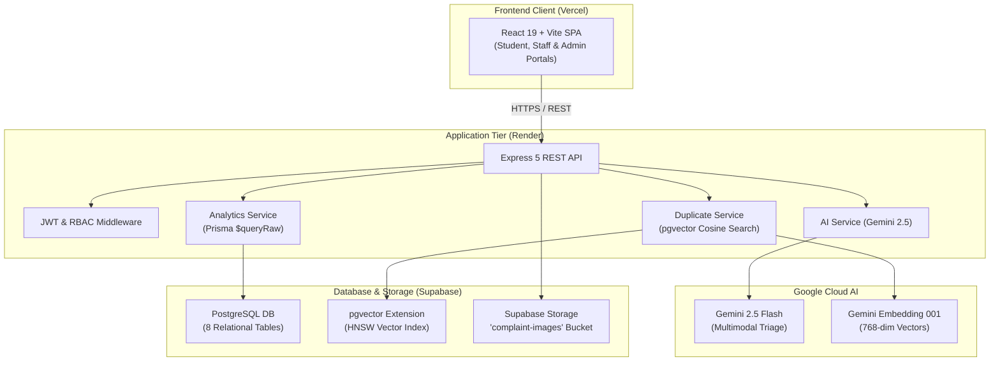
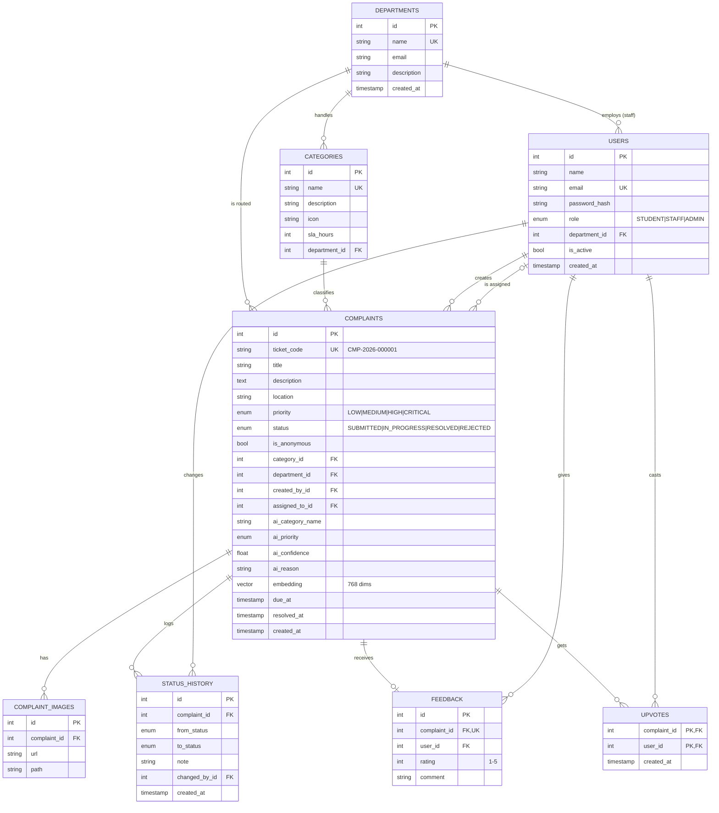

# CampusFix — Smart Campus Complaint & Grievance Management System

> **REVA University Weekend Hackathon · 24 October 2026**  
> *Problem Statement #3: Smart Campus Complaint and Grievance Management System*

[](https://opensource.org/licenses/MIT)
[](https://nodejs.org/)
[](https://supabase.com/)
[](https://www.prisma.io/)
[](https://ai.google.dev/)

---

## 1. Overview & Vision

In typical university environments, complaints regarding broken infrastructure, non-functional Wi-Fi, dirty washrooms, classroom equipment failures, and safety hazards are scattered across informal channels like WhatsApp groups, paper logbooks, and verbal complaints. This results in:
- **No audit trail or ticket accountability**
- **Unclear ownership and missed SLA resolution deadlines**
- **Duplicate tickets flooding administration**
- **Zero institutional analytics**

**CampusFix** solves this by delivering an automated, transparent, AI-assisted grievance lifecycle:
```text
Login → Submit Complaint (AI auto-fills) → Ticket ID generated → Auto-assigned to Department
      → Staff updates status (with timeline) → Resolved → Student feedback → Analytics
```

---

## 2. Key Features

- ⚡ **AI Smart Triage**: Automatically determines category, priority, and routing department from student descriptions and uploaded photos using Google Gemini.
- 🔍 **Vector Duplicate Detection**: Instant pgvector semantic similarity search (`cosine distance <= 0.20`) warns students of existing issues and offers "Me Too" upvoting.
- 🎫 **Autonomous Ticket Generation**: Sequence-backed human-readable collision-free codes (e.g. `CMP-2026-000042`).
- ⏱️ **SLA Deadline Engine**: Automatic target resolution deadlines based on category severity (e.g., Washrooms: 12h, Wi-Fi: 24h, Electrical: 24h, Safety: 4h).
- 📜 **Immutable Audit Trail**: Chronological state machine transitions (`SUBMITTED` &rarr; `IN_PROGRESS` &rarr; `RESOLVED` / `REJECTED`) with mandatory staff rationale.
- 📊 **Real-time Analytics**: KPI counters, category distribution, department resolution times, 30-day intake/closure trends, and algorithmic AI accuracy metrics.
- 📱 **Public Tracking**: Zero-login ticket tracker (`/track/:ticketCode`) for campus community transparency.

---

## 3. Technology Stack

| Layer | Technologies |
|---|---|
| **Frontend** | React 19, TypeScript, Vite, Tailwind CSS v4, shadcn/ui, TanStack Query v5, Axios, Recharts, Lucide Icons |
| **Backend API** | Node.js 20+, Express 5, TypeScript, Zod, JWT (`jsonwebtoken`), `bcryptjs`, Multer |
| **Database & ORM** | PostgreSQL 15+ on Supabase, `pgvector` extension, Prisma ORM v6 |
| **AI & ML Tier** | Google Gemini 2.5 Flash (Triage & Insights), Gemini Embedding (`gemini-embedding-001`, 768 dims) |
| **Object Storage** | Supabase Storage (`complaint-images` public bucket) |
| **Hosting & Cloud** | Vercel (Frontend), Render (Backend Web Service), Supabase (Database & Storage) |

---

## 4. System Architecture



---

## 5. Entity-Relationship (ER) Diagram



---

## 6. Pre-seeded Demo Accounts

Use these accounts to test role-based dashboards and permissions:

| Role | Email | Password | Scope / Department |
|---|---|---|---|
| **Admin** | `admin@campusfix.edu` | `Admin@123` | Global Administration & Analytics |
| **Staff (IT)** | `it.staff@campusfix.edu` | `Staff@123` | IT Services Queue & Tickets |
| **Staff (Facilities)** | `facilities.staff@campusfix.edu` | `Staff@123` | Facilities & Maintenance Queue |
| **Staff (Housekeeping)** | `housekeeping.staff@campusfix.edu` | `Staff@123` | Housekeeping & Washrooms Queue |
| **Student** | `student@campusfix.edu` | `Student@123` | Student Intake, Tracking & Feedback |

---

## 7. API Specification Summary

All endpoints conform to standard JSON envelopes: `{ success: true, data: ... }` or `{ success: false, error: { code, message } }`.

| Method | Endpoint | Auth | Purpose |
|---|---|---|---|
| `GET` | `/api/health` | Public | Service health & wake check |
| `POST` | `/api/auth/register` | Public | Student registration |
| `POST` | `/api/auth/login` | Public | Authentication (JWT return) |
| `GET` | `/api/auth/me` | Authenticated | Current profile |
| `GET` | `/api/complaints` | Role-Scoped | Filtered complaint list |
| `GET` | `/api/complaints/feed` | Public / Student | Campus open issues for upvoting |
| `POST` | `/api/complaints` | Authenticated | Create complaint (multipart + images) |
| `GET` | `/api/complaints/:id` | Scoped | Detailed ticket with audit history |
| `PATCH` | `/api/complaints/:id/status` | Staff / Admin | Advance lifecycle (`IN_PROGRESS`, `RESOLVED`, `REJECTED`) |
| `PATCH` | `/api/complaints/:id/assign` | Staff / Admin | Assign ticket to department staff |
| `POST` | `/api/complaints/:id/upvote` | Authenticated | "Me Too" vote on open complaint |
| `POST` | `/api/complaints/:id/feedback` | Owner | Submit 1–5 star rating & comments |
| `GET` | `/api/track/:ticketCode` | Public | Zero-auth tracking endpoint |
| `GET` | `/api/categories` | Authenticated | Fetch active complaint categories |
| `GET` | `/api/departments` | Authenticated | Fetch campus service departments |
| `GET` | `/api/analytics/summary` | Staff / Admin | Overall KPI metrics (overdue, resolution time, counts) |
| `GET` | `/api/analytics/by-category` | Staff / Admin | Breakdown by category |
| `GET` | `/api/analytics/by-department` | Admin | Breakdown by department |
| `GET` | `/api/analytics/trend?days=30` | Staff / Admin | Intake vs Resolution timeline |
| `GET` | `/api/analytics/ai-accuracy` | Admin | Acceptance rate of AI triage recommendations |
| `POST` | `/api/ai/analyze` | Authenticated | AI Triage recommendation for input |
| `POST` | `/api/ai/duplicates` | Authenticated | pgvector cosine similarity search |
| `GET` | `/api/ai/insights` | Admin | AI executive operational summary |

---

## 8. Environment Variables

### Backend Configuration (`backend/.env`)

```bash
PORT=4000
NODE_ENV=development

# Database Connections (Supabase)
DATABASE_URL="postgresql://postgres.<ref>:<password>@aws-0-ap-south-1.pooler.supabase.com:6543/postgres?pgbouncer=true&connection_limit=1"
DIRECT_URL="postgresql://postgres.<ref>:<password>@aws-0-ap-south-1.pooler.supabase.com:5432/postgres"

# Security
JWT_SECRET="super-secret-jwt-key-min-16-chars-long"
JWT_EXPIRES_IN="7d"
CORS_ORIGIN="http://localhost:5173"

# Supabase Storage
SUPABASE_URL="https://<ref>.supabase.co"
SUPABASE_SERVICE_KEY="<service_role_key>"
SUPABASE_BUCKET="complaint-images"

# Google Gemini AI
GEMINI_API_KEY="<google-ai-studio-api-key>"
GEMINI_MODEL="gemini-2.5-flash"
GEMINI_EMBED_MODEL="gemini-embedding-001"
AI_TIMEOUT_MS=10000
```

### Frontend Configuration (`frontend/.env`)

```bash
VITE_API_URL="http://localhost:4000/api"
```

---

## 9. Local Setup & Execution Guide

### 1. Prerequisites
- Node.js >= 20.0.0
- npm >= 10.0.0
- Supabase account with `vector` extension enabled

### 2. Backend Setup
```bash
cd backend
npm install

# Run database migrations
npm run db:migrate

# Seed realistic demo data (departments, categories, users, 60 complaints)
npm run db:seed

# Populate Gemini vector embeddings
npm run db:embed

# Start backend server
npm run dev
```

### 3. Frontend Setup
```bash
cd ../frontend
npm install
npm run dev
```
Open [http://localhost:5173](http://localhost:5173) in your browser.

---

## 10. Screenshots & UI Demonstration

| AI Triage & Intake Form | Real-Time Issue Tracking |
|:---:|:---:|
|  |  |

| Operational KPI Dashboard | Duplicate Cluster Warning |
|:---:|:---:|
|  |  |

---

## 11. Team Members & Layer Ownership

| Member | Role | Core Deliverables |
|---|---|---|
| **Member 1** | Frontend Lead | React 19 SPA, Tailwind v4 UI, shadcn components, Forms & Dashboards |
| **Member 2** | Backend & Deployment Lead | Express 5 API, Auth/RBAC, Gemini Triage/Insights, Cloud Hosting |
| **Member 3** | Database & Data Architect | Supabase schema, pgvector similarity engine, Seed data, Analytics SQL queries |
