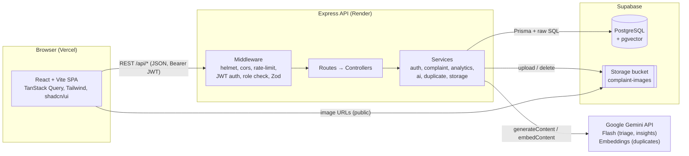
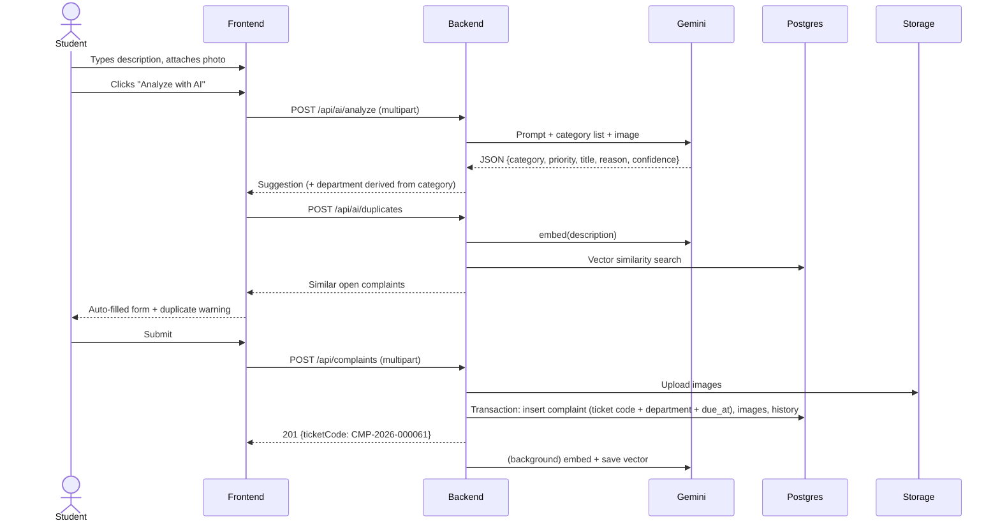

# CampusFix architecture

Backend lead copy of the diagrams in `MASTER_PLAN.md` Section 6. The frontend talks only to the Express API; the API is the only process that holds `SUPABASE_SERVICE_KEY` and `GEMINI_API_KEY`.

## System

## Request flow when creating a complaint

## Design decisions

- The backend derives the **department from the category**. It never trusts the client or the AI for routing.
- The AI only **suggests**. The user can change any field. We store both the AI suggestion and the final choice, which gives us the AI accuracy metric.
- If Gemini fails or is rate-limited, the backend falls back to keyword rules (`source: "fallback"`). The app never breaks because of AI.
- Embeddings are generated in the background after the complaint is created, so creating a complaint never waits on AI.
- All multi-step writes (create, status change, assign) use Prisma transactions.
