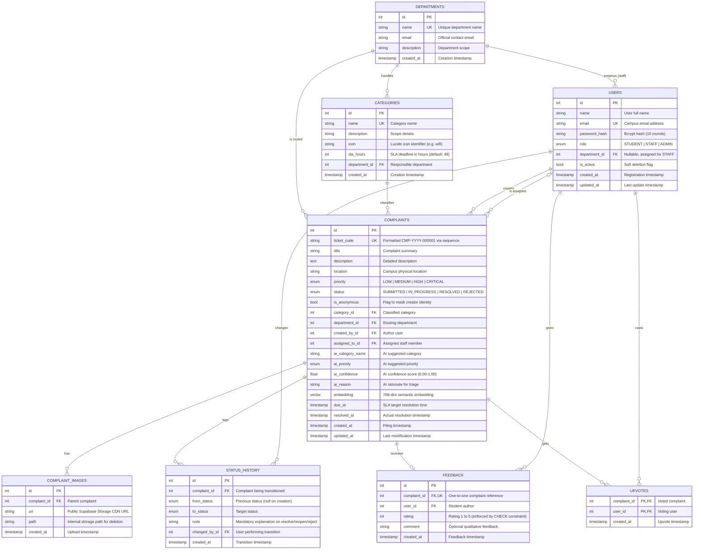

# CampusFix — Entity-Relationship (ER) Diagram & Database Architecture

## 1. Overview
This document specifies the database architecture and entity-relationship models for **CampusFix** (Smart Campus Complaint and Grievance Management System). The schema is implemented using **PostgreSQL** on **Supabase** with the **pgvector** extension and managed through **Prisma ORM**.

---

## 2. Mermaid Entity-Relationship Diagram



---

## 3. Key Architectural Concepts

### 3.1 pgvector Semantic Search
- **Embedding Column**: `Complaints.embedding` is typed as `vector(768)` to store Google Gemini (`gemini-embedding-001` or `text-embedding-004`) embeddings.
- **Index**: Indexed using **HNSW (Hierarchical Navigable Small World)** with cosine distance:
  ```sql
  CREATE INDEX IF NOT EXISTS complaints_embedding_idx
    ON "complaints" USING hnsw (embedding vector_cosine_ops);
  ```
- **Similarity Metric**: Cosine similarity (`1 - (embedding <=> query_vector)`). Allows instant duplicate detection during student complaint intake.

### 3.2 Autonomous Ticket Sequencing
- Independent PostgreSQL sequence:
  ```sql
  CREATE SEQUENCE IF NOT EXISTS complaint_ticket_seq START 1;
  ```
- Generates human-readable, collision-free codes formatted as:
  `CMP-2026-000042` (`'CMP-' || to_char(now(), 'YYYY') || '-' || lpad(nextval('complaint_ticket_seq')::text, 6, '0')`).

### 3.3 Complete Audit Trail & State Machine
- Every complaint lifecycle transition (`SUBMITTED -> IN_PROGRESS -> RESOLVED / REJECTED`) creates an immutable row in `status_history`.
- Stores `from_status`, `to_status`, staff `note`, and the actor `changed_by_id`.
- Handled atomically inside database transactions.

### 3.4 SLA & AI Accuracy Metrics
- SLA deadline (`due_at`) is automatically calculated as `created_at + category.sla_hours`.
- `ai_category_name` and `ai_priority` are saved alongside user final choices to measure algorithmic acceptance rate:
  $$\text{AI Category Accuracy} = \frac{\sum (\text{ai\_category\_name} = \text{category.name})}{\sum (\text{ai\_suggested})}$$
